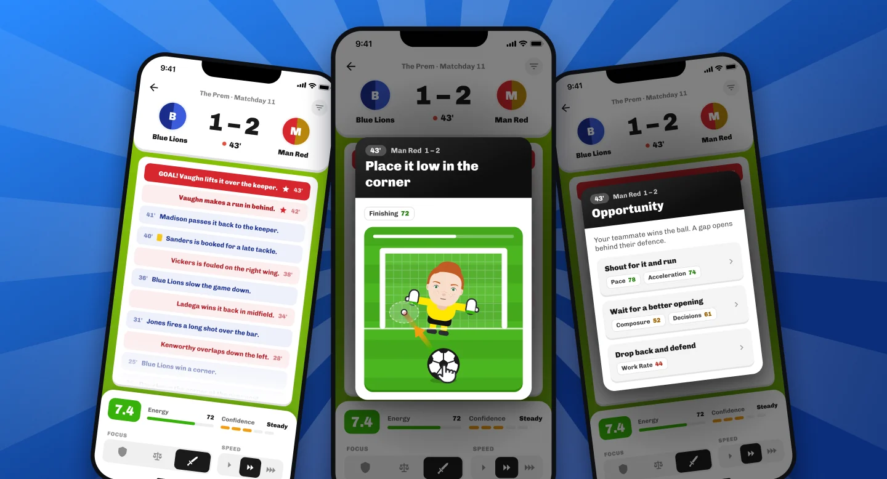
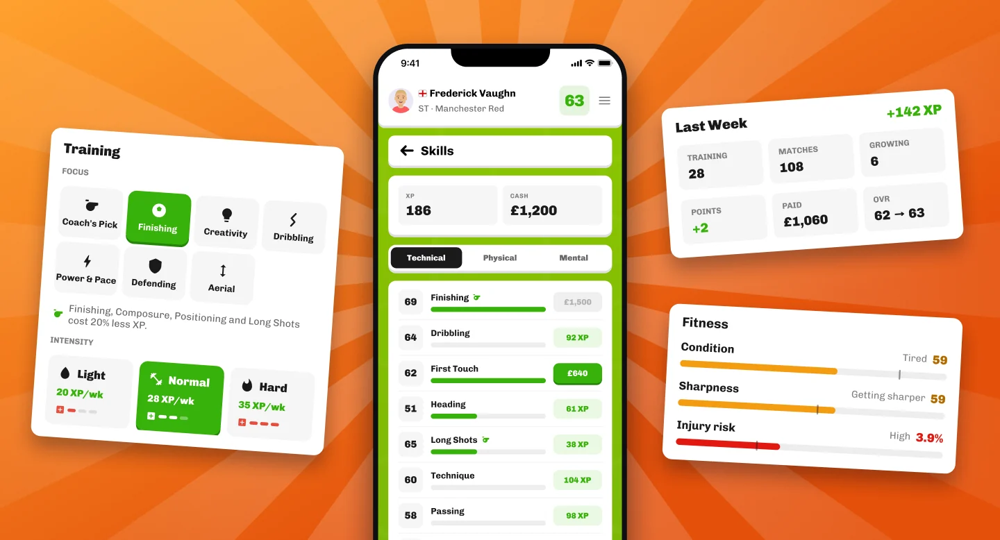
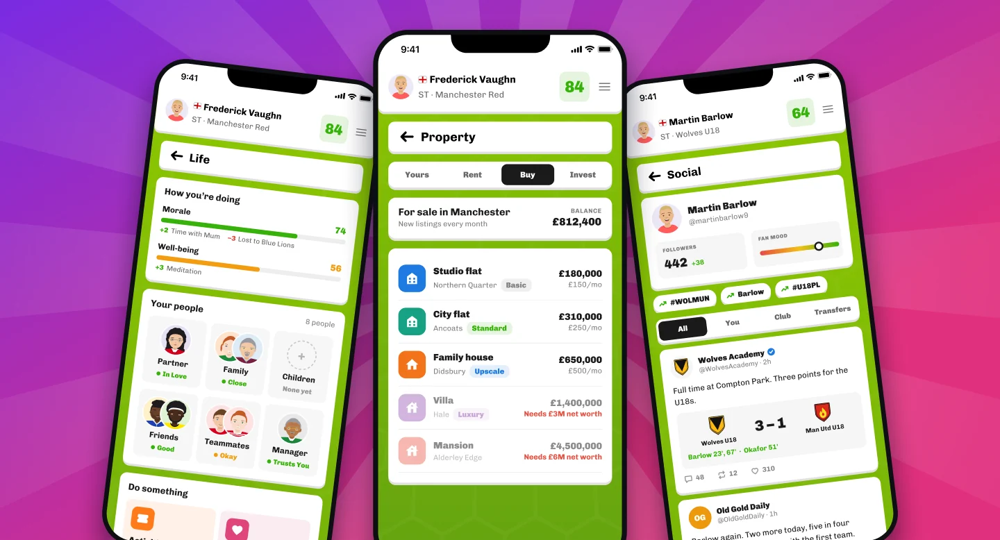
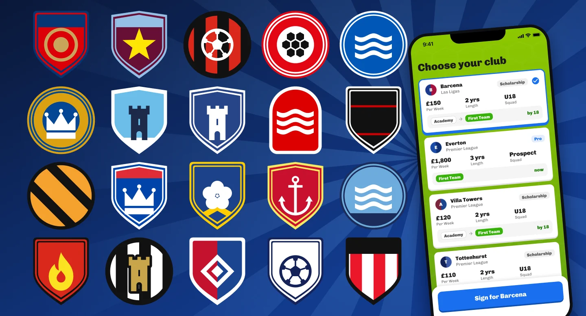

## We're Back

It's been a long time since our last update, and that's on us. Development slowed down for a while, but work is back in full swing, and the game is now much further along than when we last wrote to you.

So instead of telling you about it, we'd rather show you. Everything below is from the game as it stands today, though it's all still in development and some of it will change.

## A New Name

First, the game now has a new name: **Pro Footballer Life**. It says exactly what the game is about. You aren't managing a club. You're one player, living one career, and everything that comes with it.

## Matches You Actually Play

Matches have been completely reworked. You follow the action minute by minute with live commentary, and when a big moment comes, you decide what to do. Your skills show you which options suit your player.

Then you pull it off yourself. The biggest moments now turn into quick one-thumb mini-games. Pick your corner and nail the power on a shot, thread a pass, time a tackle or get a hand to a save. How well you do helps decide what happens next.

<small>Live commentary, shot mini-games and match decisions.</small>

## Build Your Player

Training has been rebuilt too. You earn XP from matches and training, then choose where to spend it, so your player develops the way you want. Each week you can pick a training focus and decide how hard to push, while keeping an eye on your fitness, sharpness and injury risk.

<small>Spend XP on your skills, set your training and watch your fitness.</small>

## A Life Off the Pitch

Football is only half of it. You've got a partner, family, friends and teammates to keep happy, and money to spend. You can buy a home, rent one out or build up a property portfolio as your wages grow.

There's also a new social feed, where fans, journalists and even your family react to how you're doing. Have a good week and they love you. Have a bad one and you'll hear about it.

<small>Your people, your property and everyone's opinion of you.</small>

## A Whole Football World

The world your career plays out in has grown a lot. There are now more than 50 leagues and over 800 clubs across 24 countries, each club with its own crest. Start with a scholarship at 16 or a pro contract at 18, choose between the clubs that want you, and work your way up. Play well enough and your national team may come calling too.

<small>A few of the crests, and the screen where you choose your first club.</small>

## What's Next

We're still working towards release, and we don't have a date to share yet. When we do, you'll hear it from us first. We'll be posting more often from now on, and our Discord is the best place to follow along, share your ideas and hear about the beta.

[Join Us on Discord](https://discord.gg/hwDFc2S94Y)

Thanks for sticking with us. We can't wait for you to play it.
